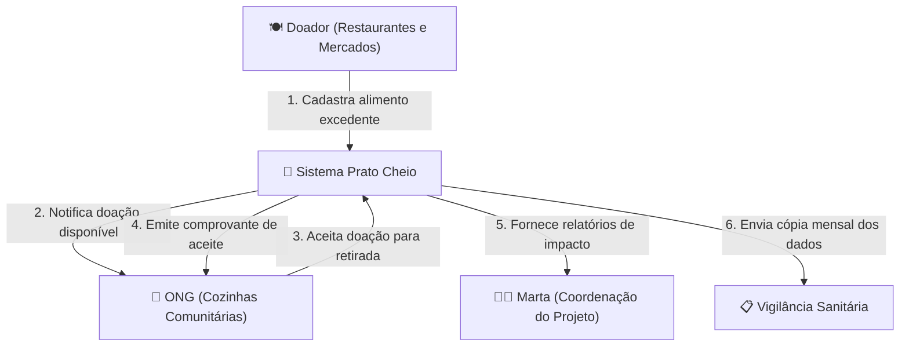

Pergunta: Quem interage com o sistema Prato Cheio e quais fluxos de dados conectam os doadores, beneficiários e órgãos reguladores?
Decisão que sustenta: Aplicação web centralizada para intermediação de alimentos excedentes com registro auditável para fiscalização (ADR 0001).
Situação: retrato da main no commit 99ef39d

