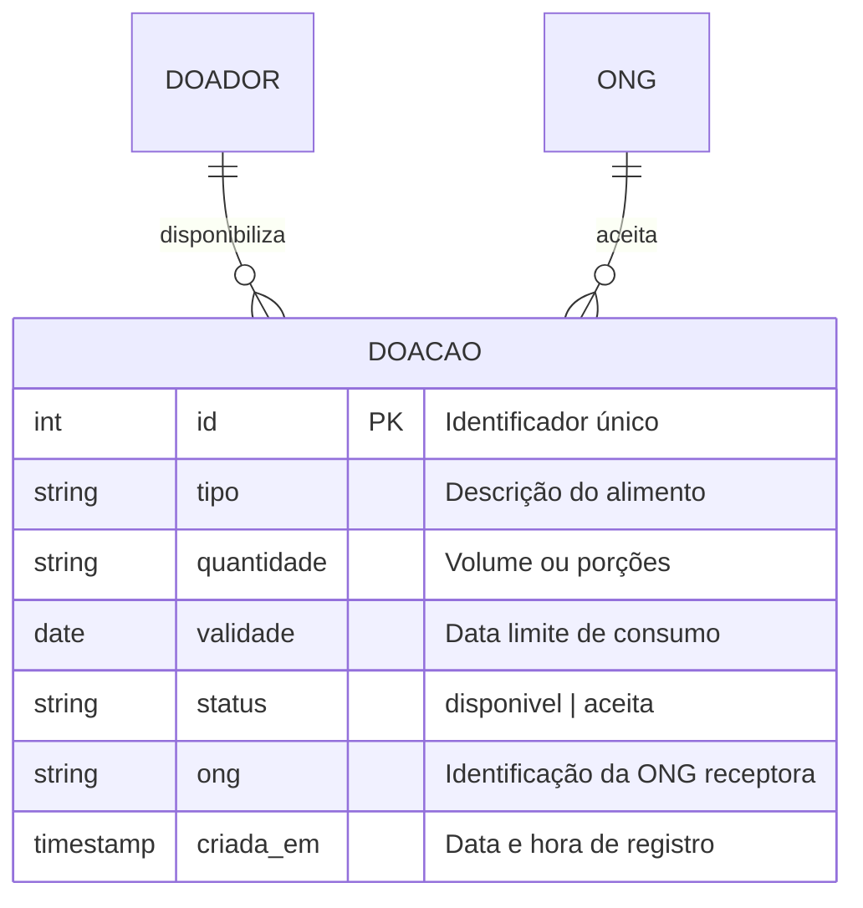

Pergunta: Como os dados de doação são estruturados para garantir rastreabilidade, controle de ciclo de vida e atendimento às regras de negócio?
Decisão que sustenta: Persistência relacional em tabela única com campos obrigatórios de validade, quantidade e rastreamento de aceite por status (ADR 0001 e ADR 0002).
Situação: retrato da main no commit 99ef39d

